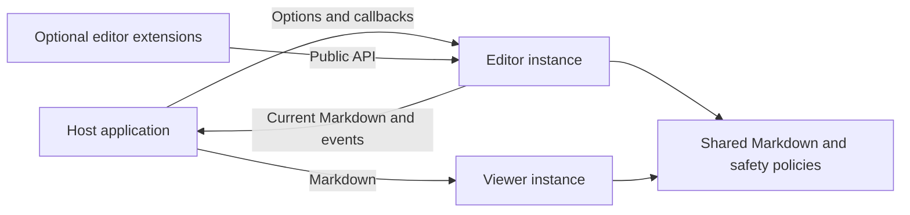

# Architecture

Markian has two independent browser entry points: an editor for writing Markdown and a lightweight viewer for displaying it. This page explains the concepts an integrator needs. Source organization is covered by the [code guide](Development/Code_guide.md).

## Documents, Sessions, and Views

The editor exposes one complete Markdown document. A view is the visible work area and its available tools; it does not own another document value.

- Visual view edits a structured document through Milkdown and ProseMirror.
- Source view edits literal Markdown through CodeMirror.
- Code and Mermaid views edit a draft for one top-level fenced block.
- Preview renders the current document without editing it.
- Help displays guidance without replacing the document.

An editing session retains its draft and history independently of the visible view. Opening Help from a code workspace suspends that presentation. Back returns to the workspace without losing its draft. Back from the workspace applies the changed block as one parent-document undo step.

`get()` returns the complete document including pending drafts, not Help text, preview HTML, or only a block's source. Different host replacements during pending work require an explicit policy; see [document replacement](API.md#document-replacement).

## Editor and Viewer

A read-only or disabled editor keeps its nonmutating controls: selection, search, copying, source inspection, Help, navigation, and fullscreen. It blocks user document changes without discarding drafts or history. Trusted host replacement remains available.

The viewer does not construct an editor or load editing engines. It retains the exact Markdown supplied by its host and creates disposable sanitized output. Tasks are always disabled. Its value, theme, callbacks, DOM, and pending render work are instance-local.

Editor Preview and viewer share Markdown parsing, safe rendering, heading anchors, and content typography. They need not have identical DOM. An editor/viewer comparison page intentionally loads both bundles; display-only hosts need only viewer assets.

## Host Responsibilities

Markian owns editing, presentation, validation, cancellation signals, and rejection of obsolete results. The host owns file access, storage, networking, credentials, authorization, application routing, and framework bindings. There is no built-in upload client, AJAX endpoint, or save transaction.

General host callbacks are flat options such as `onImageInsert` and `onLinkSuggest`. They are trusted functions supplied by application code, never strings evaluated from Markdown. The viewer has a separate callback contract. See [configuration](Configuration.md).

Before saving, hosts await `whenIdle()` and then read `get()`. They must also serialize or recheck edits during their own asynchronous storage operation. Failed current-document image insertions block the save gate until retried or explicitly removed.

## Extensions and Dependencies

Register trusted editor extension factories once, then enable them separately for each instance. Registration alone does not activate a feature or load its optional dependencies. Unknown enabled IDs are configuration errors. Applications and extensions use the same commands, registries, views, and source handles.

The bundled Code extension provides expanded block editing. The bundled Mermaid extension provides diagrams and a source/preview workspace. A separate viewer-Mermaid adapter only renders diagrams. All retain ordinary fenced Markdown; no renderer output becomes the saved value.

Hosts supply the Mermaid renderer. See [Mermaid configuration](Configuration.md#mermaid) for integration and the [Mermaid extension guide](Development/Extensions/Mermaid_extension.md) for implementation details.

| Dependency | Role |
| --- | --- |
| Milkdown and ProseMirror | Visual document structure, transactions, selection, and history. |
| CodeMirror | Source and block editing, selection, and local history. |
| remark/mdast and rehype | CommonMark/GFM parsing, Markdown comparison, and safe HTML generation. |
| rehype-sanitize and DOMPurify | Display sanitization, including optional renderer output. |
| Selected MDI icons and Codicons | Compact controls without a remote icon font. |
| Optional host Mermaid 11+ | Diagram rendering only when explicitly configured and used. |

## Markdown and Safety

Markdown is the public content format. Rendered HTML and engine documents are internal representations, not persistence formats.

- Accepted visual output uses LF line endings and `-` for unordered/task markers. It preserves whether the accepted document ended with a newline; meaningful spaces and hard breaks are not trimmed.
- Visual import compares semantic Markdown trees. On initial incompatibility, exact source remains available in Source view with a diagnostic. Failed later imports retain the previous value or pending source. Diagnostics show up to five bounded structural differences and original node line locations.
- Raw editing retains literal source, including unfinished syntax. The viewer always retains exact supplied source.
- Unknown comments remain in Markdown but are invisible in normal rendering. Generated bodies stay readable without running providers. Loading a document never executes a placeholder provider.
- Other raw HTML is inert in visual editing and omitted from sanitized Preview. General HTML allowlists, templates, and mentions are unfinished; opt-in bounded hex text color is a separate supported feature.
- Front matter and resolved-reference differences may require Source view. Unsupported content must not silently disappear merely to fit the visual schema.
- Mermaid remains an ordinary `mermaid` fence; invalid diagram syntax can still be saved as source.

Treat documents and provider output as untrusted. Shared URL checks reject unsafe schemes and destinations. Optional HTML/SVG output is bounded and sanitized again; local SVG references are scoped to avoid collisions except for Mermaid, whose original IDs and CSS remain intact. These safeguards do not establish complete CSP, accessibility, or cross-browser acceptance.

## Lifecycle and Styling

Each editor owns its document, revision, selection, histories, callbacks, pending work, and DOM. Shared dependencies do not imply shared document state. Destroying an instance cancels its work, releases its owned resources, and restores the host. Destruction is idempotent.

Editor initialization waits for enabled extension initialization, configured stylesheets, engine construction, and initial import. Schema registration closes before engine construction. A rejected initialization restores the host. Preservation fallback to Source view instead resolves readiness and reports the incompatibility.

Hosts load base editor/viewer CSS explicitly. Both entry points support replacement content stylesheets and additional document-wrapper classes; the editor also accepts theme stylesheets. Markian preserves configured wrapper classes as views and rendered documents change. These are ordinary page styles, not shadow-DOM isolation, so hosts must scope them. See the [style guide](Styleguide.md).

## Distribution and Status

Consumers use prebuilt classic scripts, CSS, declarations, a manifest, size reports, and notices. No consumer build, import map, remote font, or host-framework dependency is required. Optional features ship separately rather than as one mandatory all-features bundle.

The package names are `axenox/markian` for Composer and `markian` for npm. Asset Packagist delivery as `npm-asset/markian`, external publication, and host adoption have separate acceptance gates. Distribution sizes are recorded in [the generated report](../dist/sizes.json); byte sizes are not speed measurements.

Current capabilities are described in [configuration](Configuration.md), [API](API.md), and [extensibility](Extensibility.md). Work-package history and unfinished acceptance criteria remain in the [requirements and plan](index.md#requirements-and-decisions), not in the library contract.
