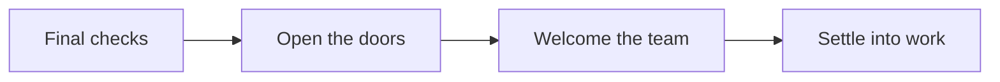

# A new place to do good work

Our riverside workspace opens on **Monday, 16 November**. This handover brings the final decisions, open tasks, and day-one details into one place.

## Before the doors open

The essentials are in place. Keep the first week simple: a warm welcome, a working desk, and someone to ask for help.

- [x] Confirm access cards with the building team
- [x] Test Wi-Fi in every meeting room
- [ ] Put welcome packs on the front desk
- [ ] Send the arrival note to the team

> A good first day starts before anyone arrives. Leave room for the little things.

## Launch checklist

| Area | Owner | Status |
| :--- | :--- | :--- |
| Front desk & access | Morgan | Ready |
| Meeting rooms | Alex | Ready |
| Welcome packs | Sam | In progress |
| Team announcement | Taylor | In review |

### Day-one details

The front desk opens at **08:30**. Guests can use the `Riverside-Guest` network; the welcome note includes access details. Read the [arrival guide](https://example.com/arrival) before the first visit.


## Opening flow



## Notes from the team

<!-- markian:placeholder {"provider":"launch-notes","id":"opening-week"} -->

Reception will be staffed throughout opening week. For anything urgent, contact **the operations team** at the front desk.

<!-- /markian:placeholder -->

### A small technical detail

Keep the status endpoint available for the welcome display:

```javascript
const workspace = {
  name: 'Riverside',
  opensAt: '08:30',
  ready: true,
};
```

---

Last reviewed by Operations. A little preparation goes a long way.